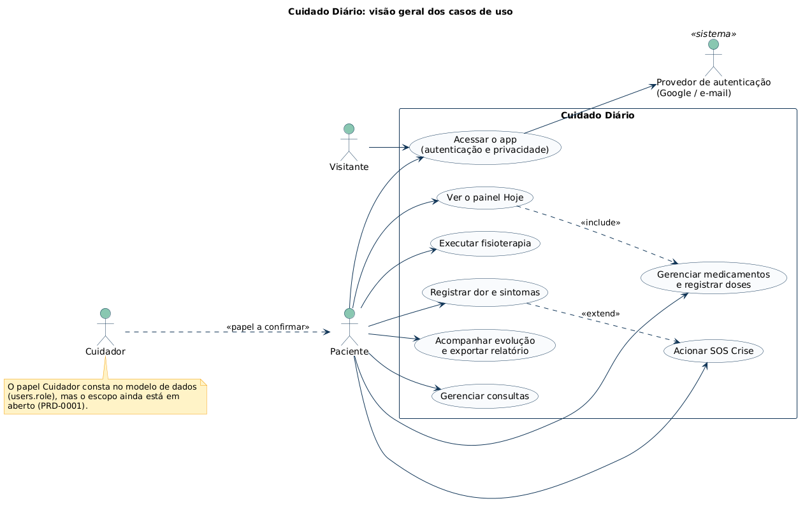
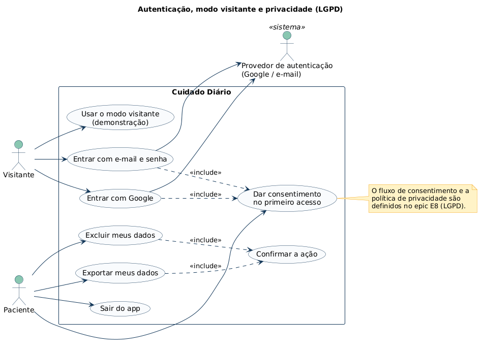
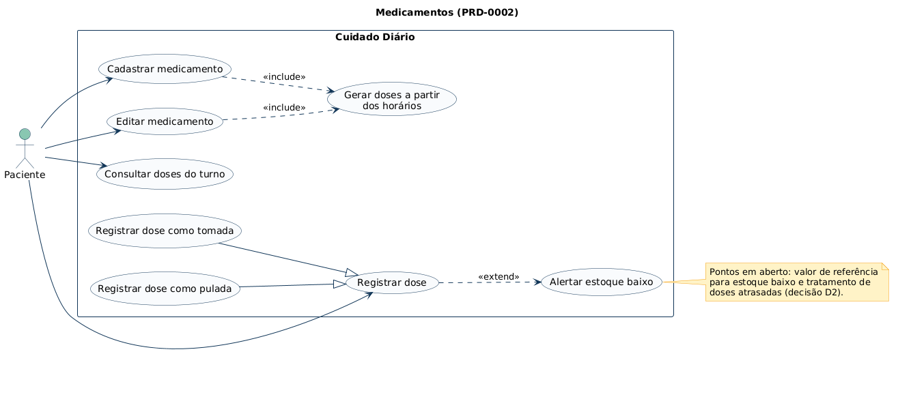
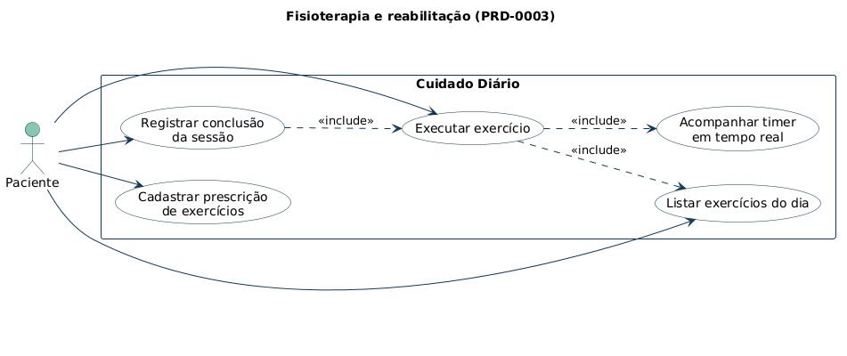
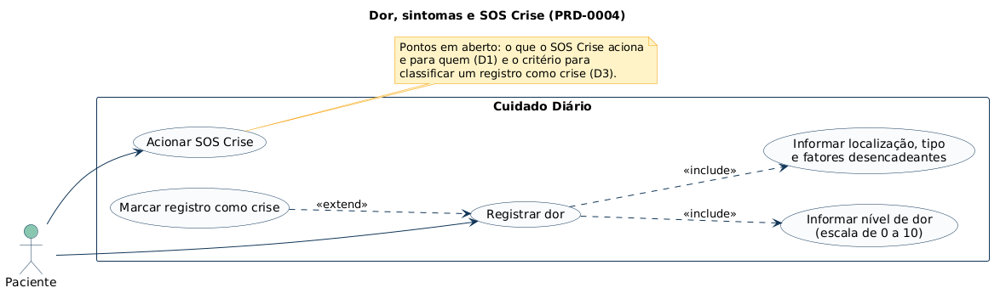
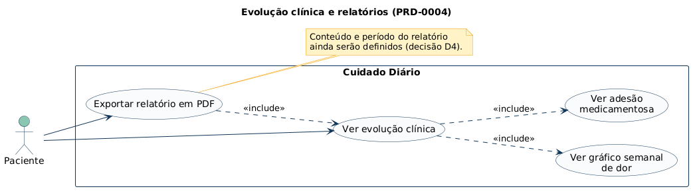
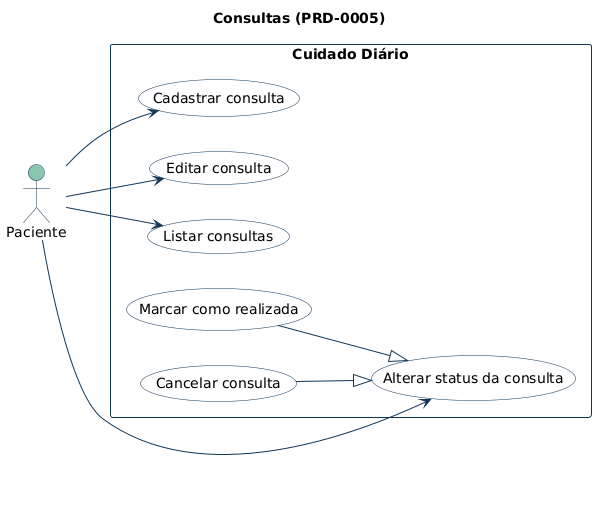
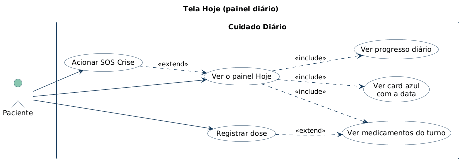

# Diagramas de caso de uso (PlantUML)

Diagramas de caso de uso do Cuidado Diário, escritos em [PlantUML](https://plantuml.com). Cada arquivo `.puml` é a fonte, e a imagem correspondente fica em `img/`.

## Diagramas

| # | Diagrama | Fonte | Imagem | Documento de origem |
| --- | --- | --- | --- | --- |
| 00 | Visão geral | [00-visao-geral.puml](00-visao-geral.puml) |  | [PRD-0001](../../products/PRD-0001-VISAO-GERAL-DO-PRODUTO.md) |
| 01 | Autenticação, modo visitante e privacidade (LGPD) | [01-autenticacao-e-privacidade.puml](01-autenticacao-e-privacidade.puml) |  | [PRD-0001](../../products/PRD-0001-VISAO-GERAL-DO-PRODUTO.md) |
| 02 | Medicamentos | [02-medicamentos.puml](02-medicamentos.puml) |  | [PRD-0002](../../products/PRD-0002-MEDICAMENTOS.md) |
| 03 | Fisioterapia e reabilitação | [03-fisioterapia.puml](03-fisioterapia.puml) |  | [PRD-0003](../../products/PRD-0003-FISIOTERAPIA.md) |
| 04 | Dor, sintomas e SOS Crise | [04-dor-e-sintomas.puml](04-dor-e-sintomas.puml) |  | [PRD-0004](../../products/PRD-0004-DOR-E-SINTOMAS.md) |
| 05 | Evolução clínica e relatórios | [05-evolucao-e-relatorios.puml](05-evolucao-e-relatorios.puml) |  | [PRD-0004](../../products/PRD-0004-DOR-E-SINTOMAS.md) |
| 06 | Consultas | [06-consultas.puml](06-consultas.puml) |  | [PRD-0005](../../products/PRD-0005-CONSULTAS.md) |
| 07 | Tela Hoje | [07-tela-hoje.puml](07-tela-hoje.puml) |  | [PRD-0001](../../products/PRD-0001-VISAO-GERAL-DO-PRODUTO.md) |

## Atores

| Ator | Descrição |
| --- | --- |
| Visitante | Usuário sem login, no modo demonstração |
| Paciente | Usuário autenticado que acompanha sua rotina de cuidados |
| Cuidador | Papel previsto no modelo de dados (`caregiver`). O escopo ainda está em aberto |
| Provedor de autenticação | Sistema externo (Google ou e-mail e senha) |

## Convenções

- `<<include>>`: o caso de uso de origem sempre usa o de destino.
- `<<extend>>`: o caso de uso de origem acrescenta comportamento opcional ao de destino.
- Seta com triângulo vazado: generalização (por exemplo, "Registrar dose como tomada" é um tipo de "Registrar dose").
- Notas amarelas: pontos em aberto dos PRDs (decisões D1 a D4 do cronograma).

## Como gerar as imagens

Os diagramas foram gerados com o PlantUML e o Graphviz. Na pasta `casos-de-uso`:

```bash
java -jar plantuml.jar -tpng -o img *.puml
```

Use `-tsvg` para gerar SVG. No VS Code, a extensão **PlantUML** mostra a prévia de cada arquivo. Ao alterar um `.puml`, gere a imagem de novo e faça o commit dos dois.
