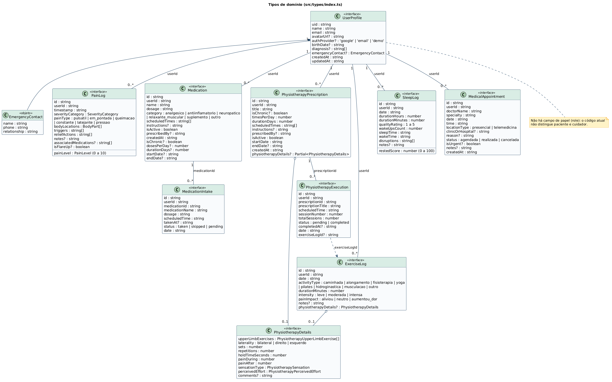
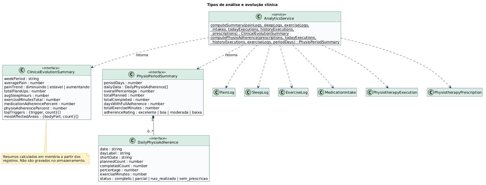
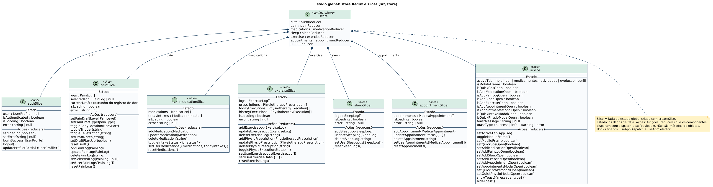
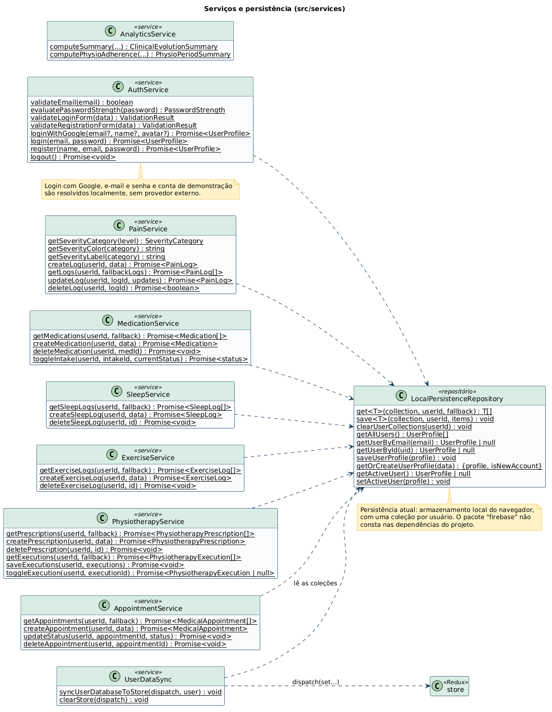
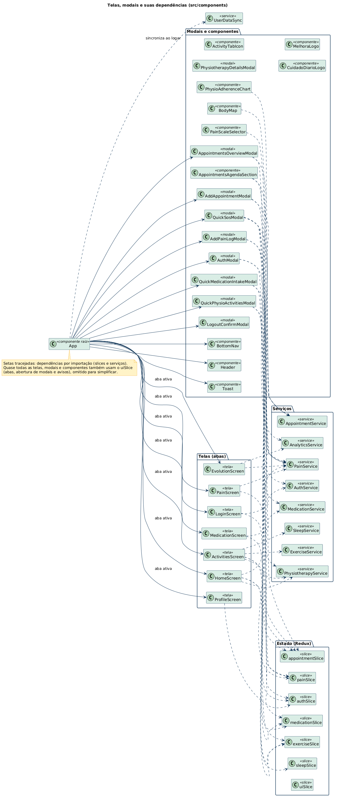

# Diagramas de classes do código (PlantUML)

Diagramas de classes e tipos extraídos do **código real** do app (`src/`), escritos em [PlantUML](https://plantuml.com). Cada arquivo `.puml` é a fonte, e a imagem correspondente fica em `img/`.

Eles complementam os diagramas de [`../classes/`](../classes/README.md), que vêm do modelo de dados descrito no [TDD-0001](../../tdds/TDD-0001-MODELO-DE-DADOS.md). Quando os dois divergirem, vale o código.

## Diagramas

| # | Diagrama | Fonte | Imagem | Código de origem |
| --- | --- | --- | --- | --- |
| 00 | Tipos de domínio | [00-tipos-de-dominio.puml](00-tipos-de-dominio.puml) |  | `src/types/index.ts` |
| 01 | Tipos de análise e evolução clínica | [01-tipos-de-analise.puml](01-tipos-de-analise.puml) |  | `src/types/index.ts` e `src/services/analyticsService.ts` |
| 02 | Store Redux e slices | [02-store-redux.puml](02-store-redux.puml) |  | `src/store/` |
| 03 | Serviços e persistência | [03-servicos.puml](03-servicos.puml) |  | `src/services/` |
| 04 | Telas, modais e dependências | [04-telas-e-dependencias.puml](04-telas-e-dependencias.puml) |  | `src/components/` e `src/App.tsx` |

## Convenções

- Os tipos TypeScript (`interface`) aparecem como classes com o estereótipo `<<interface>>`.
- Os slices do Redux Toolkit aparecem como classes `<<slice>>`. A seção **Estado** traz os dados da fatia, e a seção **Ações (reducers)** traz as funções que os componentes disparam com `dispatch`. Não são métodos de objetos. O fluxo completo está no diagrama de sequência [09](../sequencia/09-fluxo-redux-registrar-dose.puml).
- Os serviços são classes com métodos estáticos (`{static}`).
- No diagrama 04, as setas tracejadas indicam dependência por importação. As ligações com o `uiSlice` foram omitidas, porque quase todos os componentes o usam.

## Divergências entre a documentação e o código

Ao ler o código, apareceram diferenças em relação aos documentos deste repositório. Elas valem ser revisadas:

| Tema | Documentação | Código |
| --- | --- | --- |
| React | React 18 (README e [ADR-0001](../../architecture/ADR-0001-USAR-REACT-TYPESCRIPT-VITE.md)) | `react` na versão 19 no `package.json` |
| Persistência | Firestore ou PostgreSQL ([ADR-0004](../../architecture/ADR-0004-PERSISTENCIA-ADAPTAVEL.md)) | `LocalPersistenceRepository`, armazenamento local do navegador. O pacote `firebase` não está nas dependências |
| Autenticação | Google, e-mail e senha em provedor externo | `AuthService` resolve o login localmente, incluindo a conta de demonstração |
| Papéis | `role`: `patient` ou `caregiver` ([TDD-0001](../../tdds/TDD-0001-MODELO-DE-DADOS.md)) | `UserProfile` não tem campo de papel |
| Registro de dor | `level`, `location`, `type`, `isCrisis` | `painLevel`, `severityCategory`, `painType`, `bodyLocations`, `triggers`, `reliefActions`, `isFlareUp` e outros. Os fatores desencadeantes existem (`triggers`) |
| Medicamentos | `times`, `stock`, `form` | `scheduledTimes`, `category`, `isActive`, `isChronic`, `dosesPerDay`, `durationDays`, datas de início e fim. Não há campo de estoque |
| Doses | `takenTime` | `takenAt` e `medicationName` |
| Consultas | `location` | `locationType` (presencial ou telemedicina), `clinicOrHospital`, `reason`, `isUrgent`, `notes` |
| Módulos | Medicamentos, fisioterapia, dor e consultas | Também existem **sono** (`SleepLog`) e **atividades físicas** (`ExerciseLog`) |
| Relatório | Exportação em PDF | A tela de Evolução copia o texto do relatório para a área de transferência |
| SOS Crise | Comportamento em aberto (decisão D1) | Registra uma dor com `isFlareUp`, pode agendar uma consulta urgente e mostra o contato de emergência com link de ligação |

Os PRDs, o TDD-0001, os ADRs e os diagramas de caso de uso, sequência e estados foram escritos antes da leitura do código. Eles precisam ser atualizados para refletir esta tabela.

## Pontos de atenção observados no código

Ao desenhar o fluxo de uma dose, apareceram pontos que merecem ser conferidos executando o app:

- O `MedicationService` grava as doses na coleção `medication_intakes`, e o `UserDataSync` lê a coleção `intakes` ao entrar. Pelo código, o estado de uma dose pode não sobreviver ao recarregar a página.
- Na `MedicationScreen`, a dose é marcada só no Redux (`dispatch(toggleIntakeStatus(...))`), sem chamar o `MedicationService`.
- O tipo da dose aceita `skipped`, mas as telas só alternam entre `taken` e `pending`.

## Observação sobre dados de demonstração

O código contém um perfil de demonstração com nome, e-mail e telefone de contato fixos (em `authSlice.ts` e `authService.ts`). Se esses dados forem de uma pessoa real, troque-os por dados fictícios, porque o repositório é público.

## Como gerar as imagens

Na pasta `classes-codigo`:

```bash
java -jar plantuml.jar -tpng -o img *.puml
```

Ao alterar um `.puml`, gere a imagem de novo e faça o commit dos dois. Atualize os diagramas sempre que os tipos, os slices ou os serviços mudarem.
