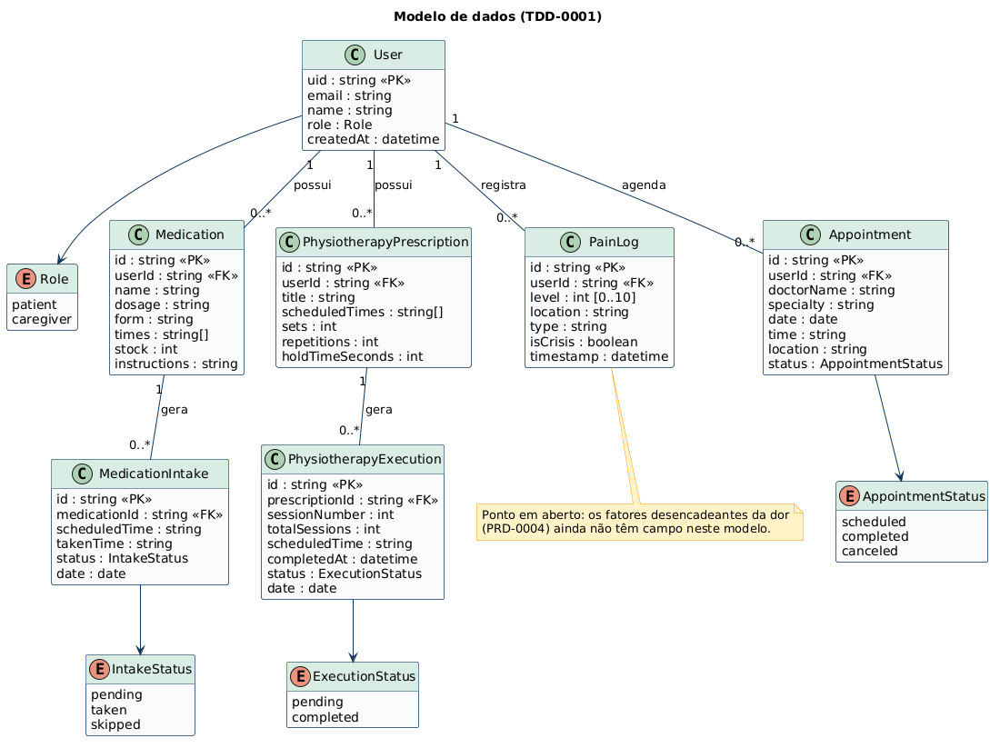
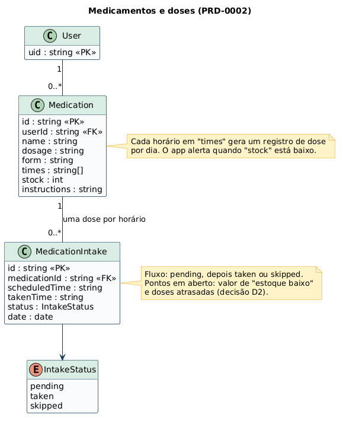
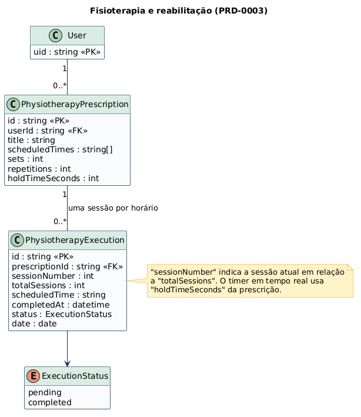
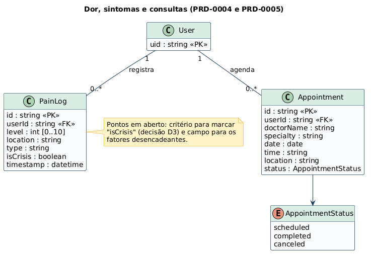

# Diagramas de classes (PlantUML)

Diagramas de classes do Cuidado Diário, escritos em [PlantUML](https://plantuml.com). Cada arquivo `.puml` é a fonte, e a imagem correspondente fica em `img/`. Eles representam o modelo de dados descrito no [TDD-0001](../../tdds/TDD-0001-MODELO-DE-DADOS.md).

## Diagramas

| # | Diagrama | Fonte | Imagem | Documento de origem |
| --- | --- | --- | --- | --- |
| 00 | Modelo de dados completo | [00-modelo-de-dominio.puml](00-modelo-de-dominio.puml) |  | [TDD-0001](../../tdds/TDD-0001-MODELO-DE-DADOS.md) |
| 01 | Medicamentos e doses | [01-medicamentos.puml](01-medicamentos.puml) |  | [PRD-0002](../../products/PRD-0002-MEDICAMENTOS.md) |
| 02 | Fisioterapia e reabilitação | [02-fisioterapia.puml](02-fisioterapia.puml) |  | [PRD-0003](../../products/PRD-0003-FISIOTERAPIA.md) |
| 03 | Dor, sintomas e consultas | [03-dor-e-consultas.puml](03-dor-e-consultas.puml) |  | [PRD-0004](../../products/PRD-0004-DOR-E-SINTOMAS.md) e [PRD-0005](../../products/PRD-0005-CONSULTAS.md) |

## Convenções

- `<<PK>>` e `<<FK>>` marcam chave primária e chave estrangeira.
- Os tipos (`string`, `int`, `datetime`) são descritivos e valem tanto para Firestore (NoSQL) quanto para tabelas SQL, conforme o [ADR-0004](../../architecture/ADR-0004-PERSISTENCIA-ADAPTAVEL.md).
- Enumerações (`enum`) mostram os valores permitidos de cada status.
- Notas amarelas indicam pontos em aberto dos PRDs. Por exemplo, os fatores desencadeantes da dor ainda não têm campo no modelo.

## Como gerar as imagens

Na pasta `classes`:

```bash
java -jar plantuml.jar -tpng -o img *.puml
```

Ao alterar um `.puml`, gere a imagem de novo e faça o commit dos dois. Mantenha estes diagramas alinhados ao TDD-0001 sempre que o modelo de dados mudar.
