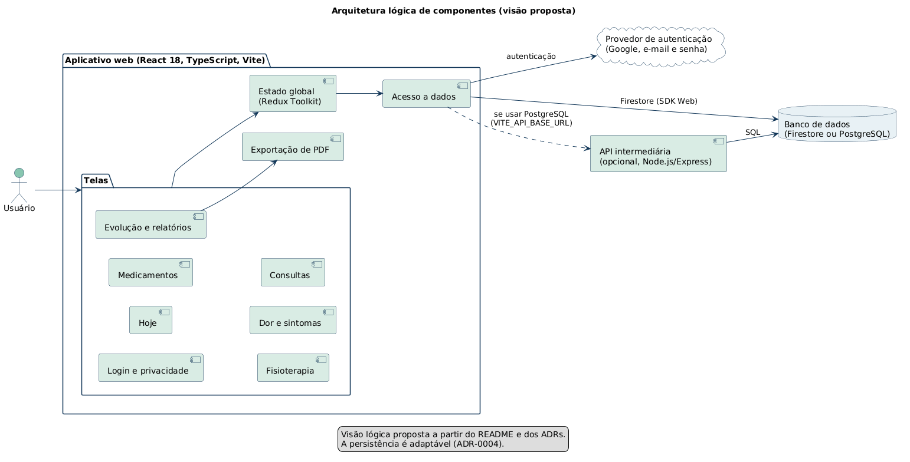
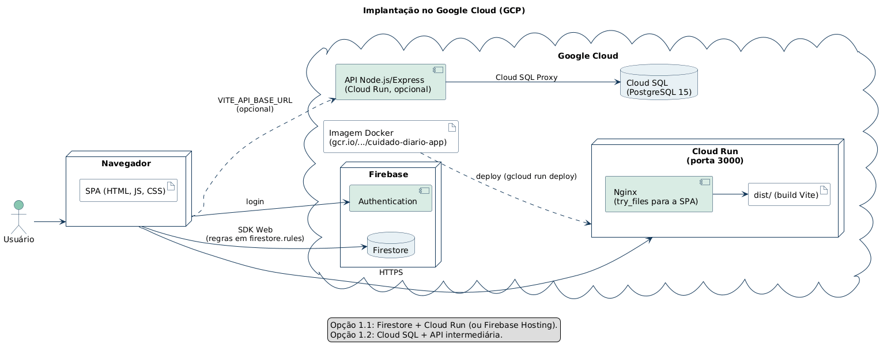
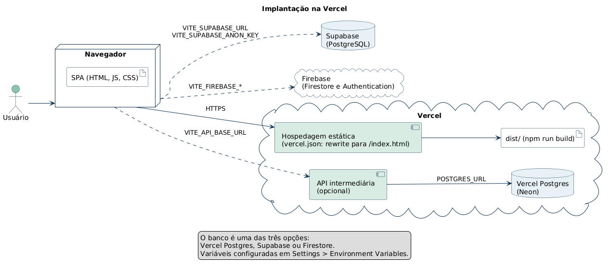
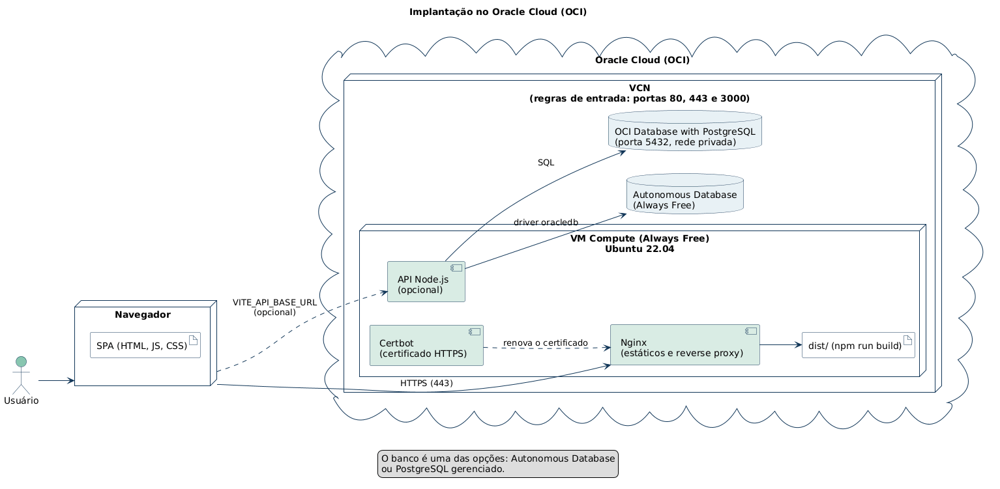

# Diagramas de componentes e de implantação (PlantUML)

Diagramas da arquitetura lógica e dos cenários de deploy do Cuidado Diário, escritos em [PlantUML](https://plantuml.com). Cada arquivo `.puml` é a fonte, e a imagem correspondente fica em `img/`.

## Diagramas

| # | Diagrama | Fonte | Imagem | Documento de origem |
| --- | --- | --- | --- | --- |
| 01 | Arquitetura lógica de componentes | [01-arquitetura-de-componentes.puml](01-arquitetura-de-componentes.puml) |  | [ADR-0001](../../architecture/ADR-0001-USAR-REACT-TYPESCRIPT-VITE.md), [ADR-0002](../../architecture/ADR-0002-USAR-REDUX-TOOLKIT.md) e [ADR-0004](../../architecture/ADR-0004-PERSISTENCIA-ADAPTAVEL.md) |
| 02 | Implantação no Google Cloud | [02-implantacao-gcp.puml](02-implantacao-gcp.puml) |  | [TDD-0002](../../tdds/TDD-0002-DEPLOY-E-AMBIENTES.md) e [ADR-0005](../../architecture/ADR-0005-DEPLOY-MULTINUVEM.md) |
| 03 | Implantação na Vercel | [03-implantacao-vercel.puml](03-implantacao-vercel.puml) |  | [TDD-0002](../../tdds/TDD-0002-DEPLOY-E-AMBIENTES.md) e [ADR-0005](../../architecture/ADR-0005-DEPLOY-MULTINUVEM.md) |
| 04 | Implantação no Oracle Cloud (OCI) | [04-implantacao-oci.puml](04-implantacao-oci.puml) |  | [TDD-0002](../../tdds/TDD-0002-DEPLOY-E-AMBIENTES.md) e [ADR-0005](../../architecture/ADR-0005-DEPLOY-MULTINUVEM.md) |

## Observações

- Os diagramas de implantação seguem os passos descritos no `README.md` da raiz do projeto. Em cada um, o banco de dados é uma das opções listadas (não todas ao mesmo tempo).
- O diagrama 01 é uma visão lógica proposta. A divisão em telas, estado, acesso a dados e exportação de PDF vem dos módulos dos PRDs e dos ADRs, e não do código. Ajuste-a à estrutura real das pastas de `src/`.
- A API intermediária (Node.js/Express) é opcional e só aparece quando o banco é relacional.
- Nunca inclua senhas ou chaves reais nos diagramas, apenas os nomes das variáveis de ambiente.

## Como gerar as imagens

Na pasta `componentes-e-implantacao`:

```bash
java -jar plantuml.jar -tpng -o img *.puml
```

Ao alterar um `.puml`, gere a imagem de novo e faça o commit dos dois.
