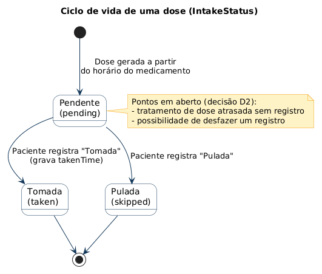
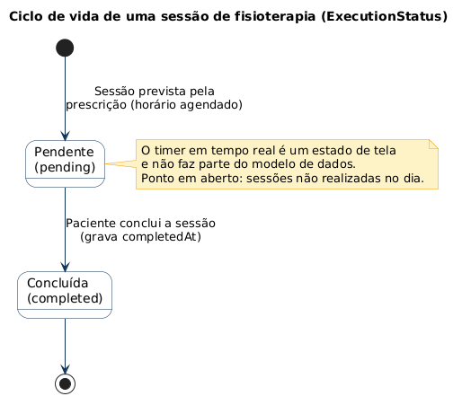
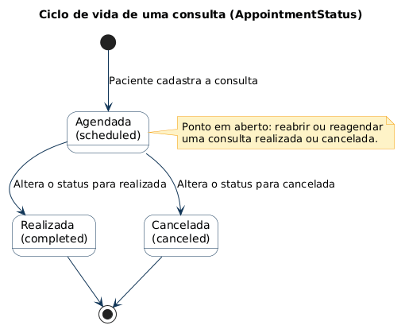
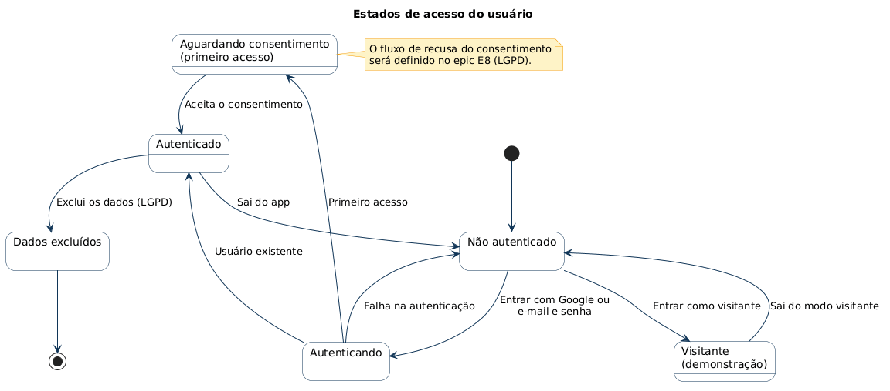
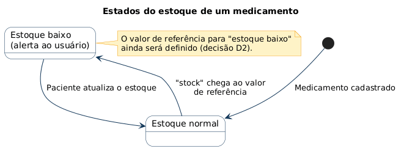

# Diagramas de estados (PlantUML)

Diagramas de máquina de estados dos principais objetos do Cuidado Diário, escritos em [PlantUML](https://plantuml.com). Cada arquivo `.puml` é a fonte, e a imagem correspondente fica em `img/`.

## Diagramas

| # | Diagrama | Fonte | Imagem | Documento de origem |
| --- | --- | --- | --- | --- |
| 01 | Ciclo de vida de uma dose | [01-dose.puml](01-dose.puml) |  | [PRD-0002](../../products/PRD-0002-MEDICAMENTOS.md) |
| 02 | Ciclo de vida de uma sessão de fisioterapia | [02-sessao-fisioterapia.puml](02-sessao-fisioterapia.puml) |  | [PRD-0003](../../products/PRD-0003-FISIOTERAPIA.md) |
| 03 | Ciclo de vida de uma consulta | [03-consulta.puml](03-consulta.puml) |  | [PRD-0005](../../products/PRD-0005-CONSULTAS.md) |
| 04 | Estados de acesso do usuário | [04-acesso-do-usuario.puml](04-acesso-do-usuario.puml) |  | [PRD-0001](../../products/PRD-0001-VISAO-GERAL-DO-PRODUTO.md) |
| 05 | Estados do estoque de um medicamento | [05-estoque-de-medicamento.puml](05-estoque-de-medicamento.puml) |  | [PRD-0002](../../products/PRD-0002-MEDICAMENTOS.md) |

## Observações

- Os estados 01 a 03 correspondem às enumerações do [TDD-0001](../../tdds/TDD-0001-MODELO-DE-DADOS.md) (`IntakeStatus`, `ExecutionStatus` e `AppointmentStatus`).
- Os diagramas 04 e 05 são estados lógicos do app, e não campos do modelo de dados. Foram montados a partir dos PRDs, então revise-os com quem conhece a implementação.
- Notas amarelas indicam pontos em aberto, como o tratamento de dose atrasada (decisão D2) e o fluxo de recusa do consentimento (epic E8).

## Como gerar as imagens

Na pasta `estados`:

```bash
java -jar plantuml.jar -tpng -o img *.puml
```

Ao alterar um `.puml`, gere a imagem de novo e faça o commit dos dois.
