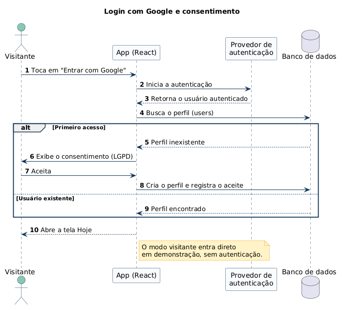
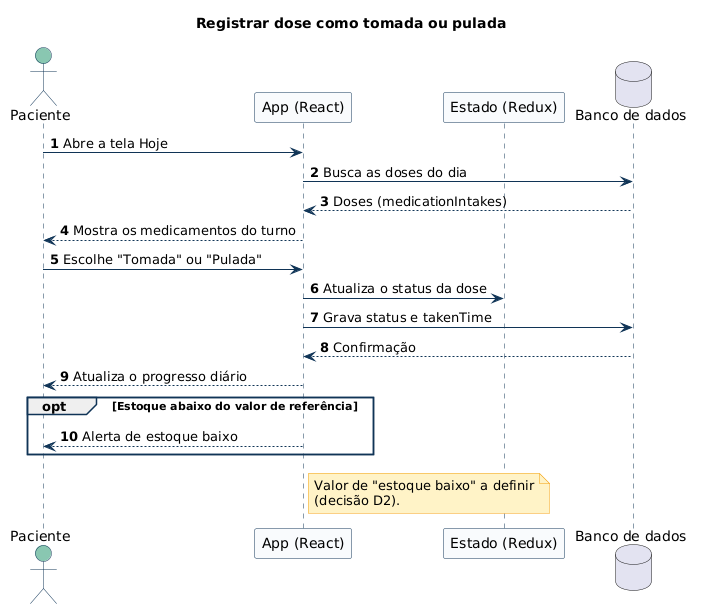
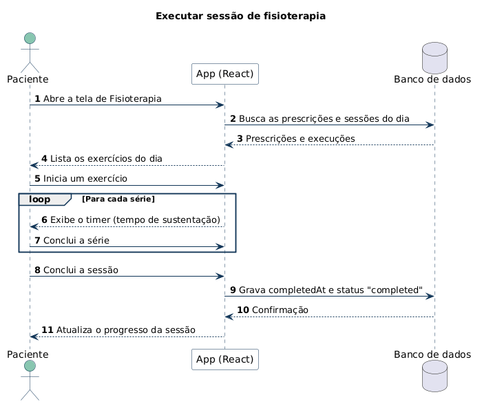
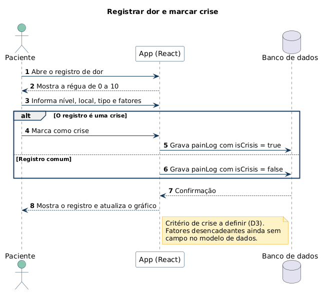
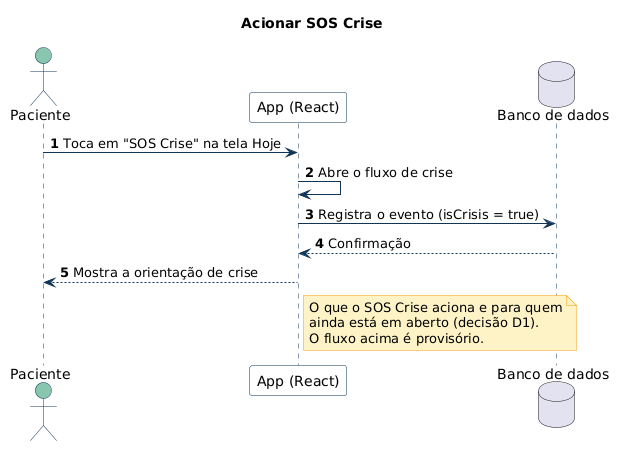
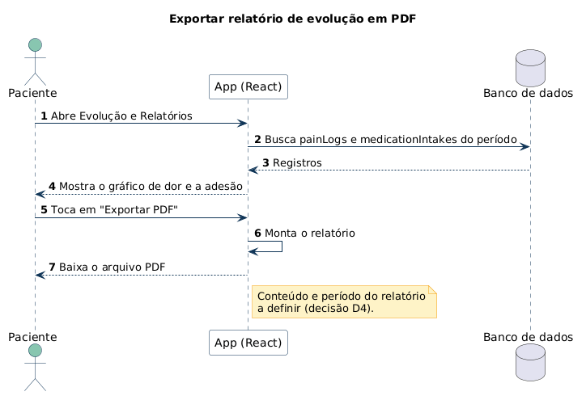
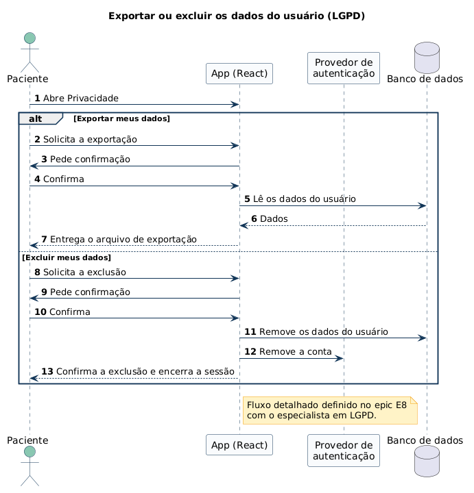
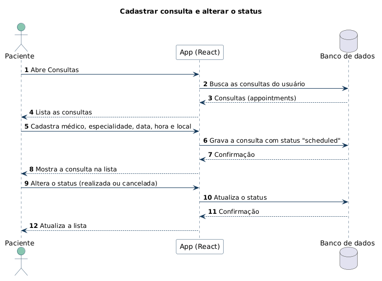
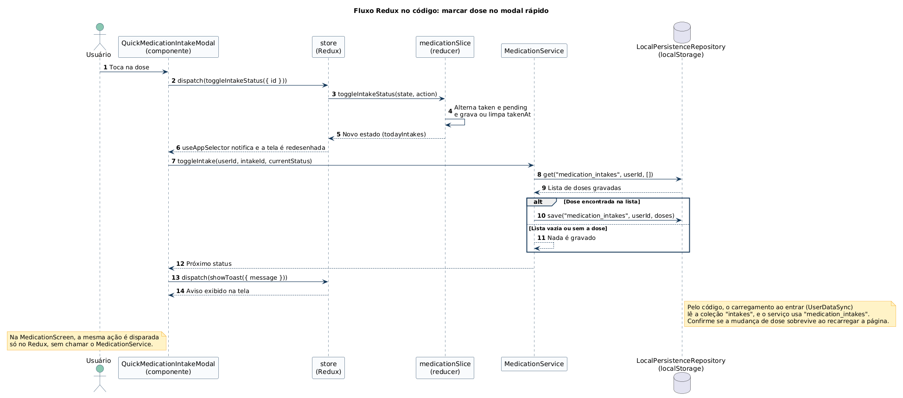

# Diagramas de sequência (PlantUML)

Diagramas de sequência dos principais fluxos do Cuidado Diário, escritos em [PlantUML](https://plantuml.com). Cada arquivo `.puml` é a fonte, e a imagem correspondente fica em `img/`.

## Diagramas

| # | Fluxo | Fonte | Imagem | Documento de origem |
| --- | --- | --- | --- | --- |
| 01 | Login com Google e consentimento | [01-login.puml](01-login.puml) |  | [PRD-0001](../../products/PRD-0001-VISAO-GERAL-DO-PRODUTO.md) |
| 02 | Registrar dose como tomada ou pulada | [02-registrar-dose.puml](02-registrar-dose.puml) |  | [PRD-0002](../../products/PRD-0002-MEDICAMENTOS.md) |
| 03 | Executar sessão de fisioterapia | [03-sessao-fisioterapia.puml](03-sessao-fisioterapia.puml) |  | [PRD-0003](../../products/PRD-0003-FISIOTERAPIA.md) |
| 04 | Registrar dor e marcar crise | [04-registrar-dor.puml](04-registrar-dor.puml) |  | [PRD-0004](../../products/PRD-0004-DOR-E-SINTOMAS.md) |
| 05 | Acionar SOS Crise | [05-sos-crise.puml](05-sos-crise.puml) |  | [PRD-0004](../../products/PRD-0004-DOR-E-SINTOMAS.md) |
| 06 | Exportar relatório em PDF | [06-exportar-relatorio.puml](06-exportar-relatorio.puml) |  | [PRD-0004](../../products/PRD-0004-DOR-E-SINTOMAS.md) |
| 07 | Exportar ou excluir dados (LGPD) | [07-exportar-excluir-dados.puml](07-exportar-excluir-dados.puml) |  | [PRD-0001](../../products/PRD-0001-VISAO-GERAL-DO-PRODUTO.md) |
| 08 | Cadastrar consulta e alterar status | [08-gerenciar-consulta.puml](08-gerenciar-consulta.puml) |  | [PRD-0005](../../products/PRD-0005-CONSULTAS.md) |
| 09 | Fluxo Redux no código: marcar dose no modal rápido | [09-fluxo-redux-registrar-dose.puml](09-fluxo-redux-registrar-dose.puml) |  | `src/components/medications/QuickMedicationIntakeModal.tsx`, `src/store/slices/medicationSlice.ts` e `src/services/medicationService.ts` |

## Participantes

| Participante | Descrição |
| --- | --- |
| Visitante / Paciente | Usuário do app |
| App (React) | Frontend da aplicação ([ADR-0001](../../architecture/ADR-0001-USAR-REACT-TYPESCRIPT-VITE.md)) |
| Estado (Redux) | Estado global ([ADR-0002](../../architecture/ADR-0002-USAR-REDUX-TOOLKIT.md)) |
| Provedor de autenticação | Google ou e-mail e senha |
| Banco de dados | Firestore ou PostgreSQL, conforme o [ADR-0004](../../architecture/ADR-0004-PERSISTENCIA-ADAPTAVEL.md) |

## Observações

- Os fluxos 01 a 08 foram montados a partir dos PRDs e do modelo de dados, e não do código do app. Revise-os com quem conhece a implementação. O fluxo 09 foi extraído do código real.
- O banco de dados aparece de forma genérica porque a persistência é adaptável.
- Notas amarelas indicam pontos em aberto, como o que o SOS Crise aciona (decisão D1).

## Como gerar as imagens

Na pasta `sequencia`:

```bash
java -jar plantuml.jar -tpng -o img *.puml
```

Ao alterar um `.puml`, gere a imagem de novo e faça o commit dos dois.
